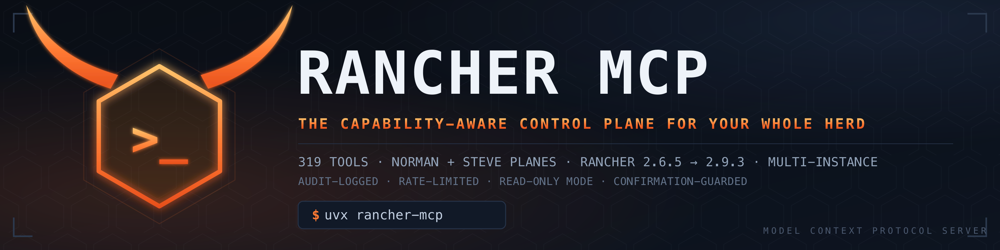
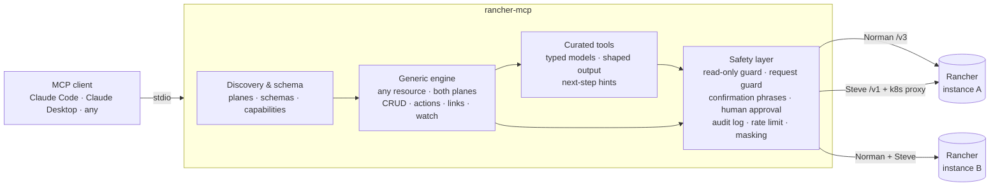

<!-- mcp-name: io.github.rex/rancher-mcp -->

<p align="center">
  
</p>

<p align="center">
  <a href="https://github.com/rex/mcp-rancher/actions/workflows/validate.yml"></a>
  <a href="https://modelcontextprotocol.io"></a>
  <a href="docs/tool-manifest.json"></a>
  <a href="https://www.python.org/"></a>
  <a href="https://github.com/microsoft/pyright"></a>
  <a href="LICENSE"></a>
</p>

<p align="center">
  Operate Rancher-managed Kubernetes through any MCP client —
  discovery, generic resource access, and curated operator workflows,
  wrapped in an audit-logged, rate-limited, confirmation-guarded safety model.
</p>

<p align="center">
  <a href="#quick-start">Quick start</a> ·
  <a href="#the-tool-surface">Tool surface</a> ·
  <a href="#architecture">Architecture</a> ·
  <a href="#safety-model">Safety model</a> ·
  <a href="#compatibility">Compatibility</a> ·
  <a href="#development">Development</a>
</p>

---

## Why this exists

Rancher is how real fleets run Kubernetes — and it speaks **two APIs** (the legacy
Norman `/v3` plane and the modern Steve `/v1` plane), varies by version, and wraps
every cluster behind its own proxy. Pointing a generic Kubernetes MCP server at it
misses everything Rancher-specific; pointing an agent at raw `kubectl` gives up
auditability, guardrails, and the management-plane view entirely.

**MCP Rancher** is built for that reality:

- **Capability-aware, not version-naive.** It detects what each connected Rancher
  actually supports instead of assuming. One binary spans **2.6.5 → 2.9.3** with
  the same tool surface.
- **Multi-instance first.** Lab, staging, prod — configure them all; mark prod
  `read_only: true` and every mutation is refused at the config layer, before any
  guard even has to fire.
- **Nothing is out of reach.** Curated tools cover the common 95%; the generic
  engine reaches *every* resource either API plane exposes — even types nobody
  wrote a tool for yet.

## The tool surface

**207 tools: 179 read-only · 28 writes · 5 destructive** — counted from the
registry itself, not by hand. [`docs/tool-manifest.json`](docs/tool-manifest.json)
is **generated from the live tool registry** (`make tool-manifest`) and a CI
gate fails the build if it ever drifts from the code. Per-tool descriptions,
safety annotations, and parameters all live there; the narrative registry with
slice tracking is [`docs/tool-catalog.md`](docs/tool-catalog.md).

| Layer | What it does | Examples |
|---|---|---|
| **Discovery & schema** | Explore what any instance can do | `rancher_server_version`, `rancher_norman_schema_list`, `rancher_capability_domain_list` |
| **Generic engine** | CRUD + actions + links + watch on *any* resource, both planes | `rancher_steve_resource_list`, `rancher_norman_resource_action_invoke`, `rancher_steve_resource_watch` |
| **Curated reads** | Typed, shaped responses across ~25 domains | `rancher_pods_list`, `rancher_deployments_list`, `rancher_longhorn_volumes_list`, `rancher_policy_reports_list` |
| **Curated writes** | Guarded mutations | `rancher_deployment_scale`, `rancher_deployment_restart`, `rancher_cron_job_suspend`, `rancher_node_cordon`, `rancher_secret_create` |
| **Operator rollups** | One-call triage, and waiting on a change | `rancher_cluster_health_check`, `rancher_find_failing_pods`, `rancher_find_stalled_rollouts`, `rancher_project_health_summary`, `rancher_rollout_wait` |

Domains covered: clusters & nodes · projects & namespaces · workloads · pods &
services · storage · networking · config & secrets *(values masked)* ·
certificates *(keys masked)* · RBAC · auth & identity · apps & catalogs ·
logging pipeline · Prometheus monitoring · policy reports · CIS compliance ·
backup operator · etcd backups · Longhorn · Fleet · provisioning · settings &
features · alerts & notifiers.

All 207 stay exposed by default — every tool schema is deferred behind
Claude Code's own search, so a small default would only help other hosts at
the good host's expense. A constrained host (a small local model, a tight
context budget) can opt into a smaller surface via `RANCHER_TOOLSETS`; see
[Toolset profiles](#toolset-profiles) under Configuration.

## Quick start

### Requirements

- [uv](https://docs.astral.sh/uv/) — it brings its own Python (3.12 or newer)
- A Rancher API token ([creating one](https://ranchermanager.docs.rancher.com/reference-guides/user-settings/api-keys))

There is nothing to clone or install first: `uvx rancher-mcp` fetches the
[package from PyPI](https://pypi.org/project/rancher-mcp/) and runs it. Start
with a read-only token, or add `RANCHER_READ_ONLY=true`, until you have seen
what an agent does with it — see the [safety model](#safety-model).

### Claude Code

```bash
claude mcp add rancher \
  -e RANCHER_URL=https://rancher.example.com \
  -e RANCHER_TOKEN=token-xxxxx:yyyyyyyyy \
  -- uvx rancher-mcp
```

### Claude Desktop, and any client that takes a JSON server entry

```json
{
  "mcpServers": {
    "rancher": {
      "command": "uvx",
      "args": ["rancher-mcp"],
      "env": {
        "RANCHER_URL": "https://rancher.example.com",
        "RANCHER_TOKEN": "token-xxxxx:yyyyyyyyy"
      }
    }
  }
}
```

`uvx` keeps using the version it first downloaded. Write `rancher-mcp@latest`
in place of `rancher-mcp` to pick up a new release.

> **On 1.59.0 or earlier? Upgrade.** Those versions do not start from a normal
> install, and 1.77.0 closed security issues that affect every version before
> it — see the [security history](SECURITY.md#security-history).

### From source

```bash
git clone https://github.com/rex/mcp-rancher.git
cd mcp-rancher
make setup                 # deps, .env scaffold, pre-commit hooks
$EDITOR .env               # set RANCHER_URL + RANCHER_TOKEN
make dev                   # run the MCP server (stdio)
```

To point a client at a checkout, use
`uv run --directory /path/to/mcp-rancher rancher-mcp` in place of
`uvx rancher-mcp`.

### Multiple instances

```env
RANCHER_INSTANCES_JSON='{
  "production": {"url": "https://rancher.prod.example.com",    "token": "token-a:xxx", "verify_ssl": true, "read_only": true},
  "lab":        {"url": "https://rancher.lab.example.com",     "token": "token-b:yyy", "verify_ssl": false, "read_only": false}
}'
RANCHER_DEFAULT_INSTANCE=production
```

Every tool takes an optional `instance` argument. Instances flagged
`read_only: true` refuse **all** mutations at the settings layer.
`RANCHER_DEFAULT_INSTANCE` has to name one of them.

## Architecture



Three layers, deliberately separate: **discovery** tells you what an instance can
do, the **generic engine** can touch anything it exposes, and **curated tools**
make the common paths typed, shaped, and self-describing (every response carries
`suggested_next_steps`). Most curated tools are **generated from YAML descriptors**
(`catalog/curated_tools/`) with a drift gate — the editorial decisions live in
descriptors, not boilerplate.

## Safety model

Built for the day an agent is pointed at the cluster that pays your salary:

| Guard | Behavior |
|---|---|
| **Read-only instances** | `read_only: true` refuses every mutation for that instance before anything is sent — and the HTTP client of a read-only instance sends nothing but reads, so a tool that failed to refuse still could not write |
| **One resource, as named** | A request goes to the resource its arguments name, by the method it was sent with — nothing else. Every identifier is checked where it enters a path (no `..`, no empty segment, no `/` where one name is meant), and the HTTP client refuses whatever gets past: a path that would resolve elsewhere, a host, a query parameter Rancher reads as a change of method, and any `DELETE` addressed to a whole Kubernetes collection |
| **Destructive confirmation** | Deletes require an explicit typed phrase (e.g. `"delete steve namespace foo"`) — no phrase, no delete |
| **Human approval** | A phrase the model can type proves the model read it; this proves a person agreed. **Any client that supports MCP elicitation** is shown a question the server worded — *Delete deployment "web" in namespace "shop" on cluster "c-m-abc"?* — with every option the call carries, and the tool does not run unless a person ticks the box and accepts. The destructive tools (deletes and action invokes) ask **every time**. The generic apply and patch tools ask too, and there a person may also tick **Keep going**: further calls of that one tool, on that one instance and cluster, then go through unasked for 15 minutes — never a delete, never another cluster. **Claude Code** additionally shows its own permission prompt on every destructive call, in every permission mode including bypass (`anthropic/requiresUserInteraction`). A client that can do neither falls back to the guards that were already there; nothing is waved through |
| **Tool annotations** | Every tool declares `readOnlyHint` / `destructiveHint` / `idempotentHint`, so clients can gate UX on them |
| **Audit log** | Every mutation emits a structured `event="audit"` record — tool, operation, plane, instance, resource, outcome — whether it completed, was refused, crashed or was cancelled. So does every approval a person gave or withheld, and every call that went through on a standing one. Argument *names* only; values never logged |
| **Rate limiting** | Token-bucket on writes (default 60/min) — a runaway loop can't machine-gun your API |
| **Secret & key masking** | Secret values and certificate private keys are structurally absent from curated responses (reveal is an explicit generic-tool opt-in) |
| **Structured errors** | Guard rejections return typed `error_code` envelopes agents can branch on — never raw strings |

## Compatibility

| | |
|---|---|
| **Primary target** | Rancher **2.9.3** (production-validated) |
| **Compatibility floor** | Rancher **2.6.5** (kept green via capability detection) |
| **API planes** | Norman `/v3` + Steve `/v1` (+ per-cluster Kubernetes proxy) |
| **MCP protocol** | `2026-07-28`, and the older `2025-11-25` handshake for clients that have not moved — one process serves both and the client chooses |
| **Transport** | stdio |

Capability detection bridges version differences at runtime — no
version-pinned builds, no "works on my Rancher." Both targets are exercised by
the same test suite, and read paths have been validated live against both a
2.6.5 lab and a 2.9.3 production fleet
([validation report](docs/live-validation-2026-05-06.md)).

## Configuration

| Variable | Default | Purpose |
|---|---|---|
| `RANCHER_URL` | — | Rancher server URL (single-instance mode) |
| `RANCHER_TOKEN` | — | API token (`token-xxxxx:yyyyyyyyy`) |
| `RANCHER_VERIFY_SSL` | `true` | TLS verification |
| `RANCHER_CA_BUNDLE` | — | Path to a CA bundle, for a Rancher behind a private CA |
| `RANCHER_READ_ONLY` | `false` | Refuse every mutation (single-instance mode; per instance it is `read_only` in the JSON) |
| `RANCHER_INSTANCES_JSON` | — | Multi-instance config (see above) |
| `RANCHER_DEFAULT_INSTANCE` | `default` | Instance used when a tool call names none. `default` is the name single-instance mode gives its one instance; with `RANCHER_INSTANCES_JSON`, set this to one of yours — the server will not start if it names none of them |
| `RANCHER_MCP_SERVER_NAME` | `rancher-mcp` | Server identity announced to clients |
| `RANCHER_MCP_SERVER_DESCRIPTION` | built-in | Server description announced to clients |
| `RANCHER_MCP_WRITE_RATE_LIMIT_PER_MIN` | `60` | Write rate limit (`0` disables) |
| `RANCHER_TOOLSETS` | `all` | Comma-separated toolset profile(s) exposed at startup — see below |
| `RANCHER_TOOLS` | — | Comma-separated tool names force-included on top of the selected profile(s) |
| `RANCHER_EXCLUDE_TOOLS` | — | Comma-separated tool names removed, applied last — always wins over `RANCHER_TOOLS` |
| `RANCHER_MCP_REQUIRE_APPROVAL_FOR_DESTRUCTIVE` | `true` | Require a person's approval for the destructive tools and for the generic apply and patch tools: an elicitation prompt in any client that can show one, plus Claude Code's permission prompt on every destructive call. Set `false` only for an unattended pipeline that legitimately changes things — there a prompt can reach nobody and the call is refused. The confirmation phrase stays either way |
| `RANCHER_MCP_APPROVAL_KEEP_GOING_MINUTES` | `15` | How long a person's "Keep going" on an apply or patch prompt lets further calls of that tool, on that instance and cluster, through unasked. `0` withdraws the offer, so every call asks. Held in memory only; it ends with the session |
| `RANCHER_MCP_CATALOG_PATH` | packaged | Override the capability catalog the server ships with |
| `LOG_LEVEL` | `INFO` | Log verbosity. Logs go to stderr; stdout is the protocol |

### Toolset profiles

The default is `all`: every tool stays exposed. Claude Code, the primary
host, defers every tool schema behind its own search, so a small default
would only help other hosts at the cost of making the good host worse — this
is a deliberate choice, not an oversight.

`RANCHER_TOOLSETS` opts a constrained host (a small local model, or a context
budget) into a smaller surface. Values are either a family name — one per
`src/rancher_mcp/tools/` module (`storage`, `workloads`, `pods_services`,
`rbac`, …; see `rancher_mcp.toolsets.FAMILY_REGISTRARS` for the full list) —
or the cross-family `core` profile: a ~32-tool triage/orientation set
(`rancher_find_*`, the health/summary rollups, core list/get pairs, and the
generic `rancher_{steve,norman}_resource_{list,get}` escape hatches). `core`
cuts the `tools/list` payload from 207 tools / ~405 KB to 32 tools / ~78 KB
(~80% smaller). Profiles compose: `RANCHER_TOOLSETS=core,storage` gives the
triage set plus everything storage-related.

```env
RANCHER_TOOLSETS=core                        # small triage surface
RANCHER_TOOLSETS=core,storage,workloads      # triage + two full families
RANCHER_TOOLS=rancher_secret_get             # add one extra tool on top
RANCHER_EXCLUDE_TOOLS=rancher_secret_create  # remove one, wins over the above
```

An unknown profile name fails loudly at startup rather than silently
producing an empty or shrunken surface. Calling a real tool that exists but
isn't in the active profile returns a structured `TOOLSET_NOT_ENABLED` error
naming the tool, the toolset that would enable it, and the env var to set —
never a bare "unknown tool", which would make a disabled tool indistinguishable
from a typo.

### Front-door tools

Because Claude Code defers tool definitions, the model's first Rancher call
normally costs a tool-search round trip. Five tools opt out and load upfront —
the ones that are plausible *first* calls in a session:
`rancher_clusters_health_summary`, `rancher_cluster_health_check`,
`rancher_find_failing_pods`, `rancher_find_unready_nodes` and
`rancher_resource_events`. They carry `_meta["anthropic/alwaysLoad"]`, cost
about 590 tokens of context between them, and a test budgets the set so it
cannot grow by accretion.

Other clients ignore the hint. To defer everything again in Claude Code, set
`"alwaysLoad": false` on this server's entry in your MCP configuration.

## Project status

Shipping and stable for **read, triage, and guarded write** operations. Honest
ledger of what's beyond that:

- **Destructive workflows** (node drain, etcd/backup restore, cert rotation,
  cluster upgrade/delete) are **roadmap** — deliberately staged after real-world
  read-path mileage. The generic engine + confirmation guard already covers
  these cases for operators who need them today.
- The Alertmanager routes/silences surface needs an in-cluster API integration
  and is deferred.
- The full per-version compatibility matrix (Track G) is in progress; the
  [first live validation run](docs/live-validation-2026-05-06.md) covers the
  read matrix on both targets.

Work is tracked to the tool level: [`docs/tool-catalog.md`](docs/tool-catalog.md)
(every tool has a row, every gap a slice ID) and [`ROADMAP.md`](ROADMAP.md).

## Development

```bash
make help               # every target, documented
make validate           # codegen drift + manifest drift + architecture + lint + typecheck + tests
make smoke-wheel        # build the wheel, run it from an empty directory, handshake on both protocol eras
make tool-manifest      # regenerate docs/tool-manifest.json from the registry
make lab-up             # local Rancher 2.6.5 lab (kind + helm), fully scripted
make integration-current # isolated Rancher 2.14.3 end-to-end test run
make live-read-matrix   # read-only validation probes against configured instances
make mock-rancher       # fixture-backed mock Rancher for provider-config testing
```

- **Local lab** — a self-contained Rancher 2.6.5 on kind with a simulated
  downstream cluster; repo-local kubeconfigs, never touches your machine state.
- **Current integration lab** — Rancher 2.14.3 on separate Kind clusters and
  port `9443`; run it serially with `make integration-current` to avoid
  overlapping Docker resource demand with the legacy lab.
- **Contract fixtures** — sanitized captures from live Rancher committed under
  `tests/fixtures/`; `respx` pins the HTTP boundary in tests.
- **Codegen** — curated tools are emitted from `catalog/curated_tools/*.yml`
  descriptors; `make check-codegen` fails on drift.
- **Fleet-wide gates** — the safety model is tested by calling *every* tool
  through the real request path with the network intercepted, not tool by
  tool: every tool that can write obeys read-only mode, the rate limit and the
  audit log; every result matches its published schema; every tool that asks a
  person takes no for an answer; and every string argument of every tool is
  given hostile values to see what reaches the wire. A tool added tomorrow is
  covered the day it is registered.
- **Gates** — ruff, pyright strict, the test suite with a coverage floor, architecture
  line-limits, module-shape checks, secret scanning. All fail closed, all wired
  into pre-commit.

Stack: Python 3.12 · [MCP Python SDK 2.x](https://github.com/modelcontextprotocol/python-sdk) ·
[httpx](https://www.python-httpx.org/) · [Pydantic v2](https://docs.pydantic.dev/) ·
[structlog](https://www.structlog.org/) · [uv](https://docs.astral.sh/uv/)

## Security

See [SECURITY.md](SECURITY.md) for the threat model, token guidance, and how to
report vulnerabilities.

## License

[MIT](LICENSE)
